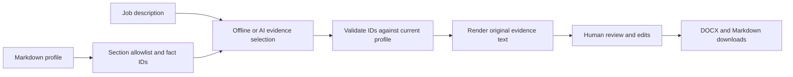

# Architecture and scope

The supplied Copilot agent is a behavioral specification, not an executable web service. This implementation adapts its truthfulness, person isolation, source attribution and export-review requirements without importing its package identity or personal data into Git.

`resume_builder.py` contains parsing, selection, audit reporting and export. `app.py` contains session-scoped inputs and review state. `examples/` contains synthetic data only. The optional model chooses IDs, never the final resume wording. Invalid output cannot add arbitrary model text to the document. Uploaded documents and JDs are treated as data rather than trusted model instructions.

Fact IDs are local to one parsed profile; the UI discards results when inputs change. They are not durable global identifiers. Original input order preserves chronological presentation. Source section, job context and original bullet text accompany every fact. The parser excludes unrelated sections but does not prove that uploaded facts are true or safe: users must review their sources and resolve contradictory claims.

The prototype has no autonomous loop, browser agent, job scraping, email delivery or external write actions. It needs no agent orchestration framework. Export is local generation, followed by an explicit user download. Document edits invalidate review approval. No profiles or outputs are persisted by application code.

Evaluation focuses on unsupported qualification leakage, text preservation, source isolation and stale draft invalidation. Live model behavior needs additional evaluation once API access is configured; mocked adapter tests only validate the integration contract.
